# DanLume · 手机版

把桌面版 DanLume 的**日历、邮箱、教务通知、备忘、作业、eHall、空教室、文档、文献库、公式、AI 助手**
装进手机：一个可以添加到主屏幕、离线也能用的移动端应用。

> 手机用户可以直接安装 **DanLume-1.3.2.apk**：首次进入先验证复旦身份，
> 之后自动同步课表与通知，不需要电脑、也不需要 start.bat。

界面沿用原作的浅色圆角 + 磨砂质感：亚麻底色、鼠尾草绿强调色、Apple 系统色日程、
8 套强调色 / 6 套背景 / 深浅主题 / 字体切换。

| 仪表板 | 日历 |
| --- | --- |
| 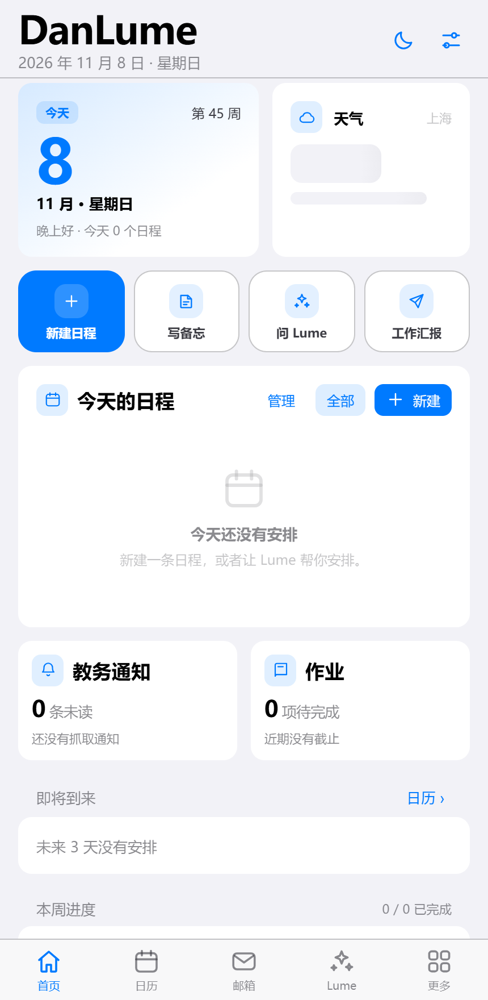 | 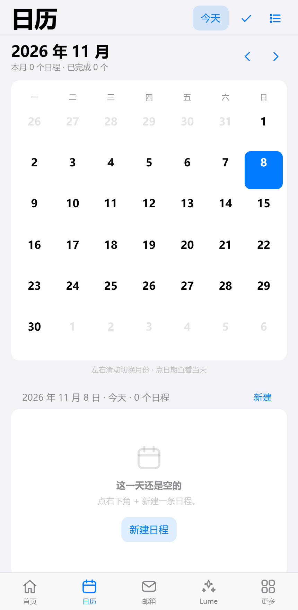 |

| Lume（AI 助手） | 备忘 |
| --- | --- |
| 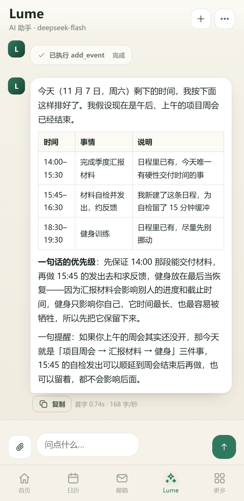 | 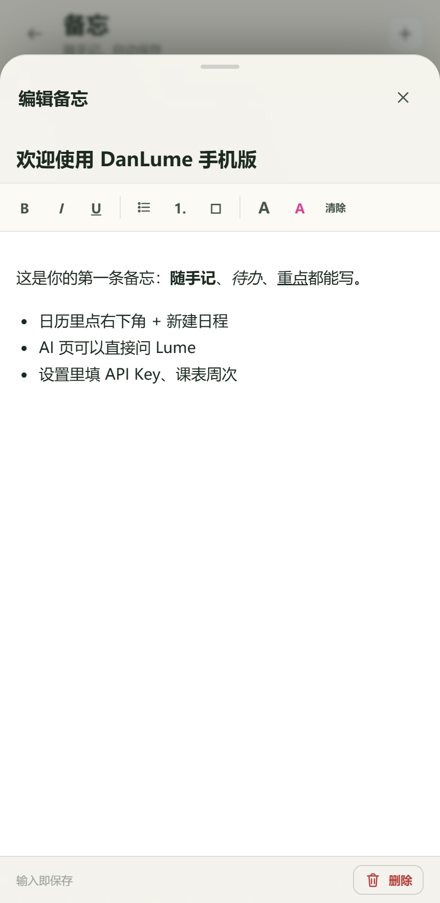 |

| 空教室 | 公式 |
| --- | --- |
| 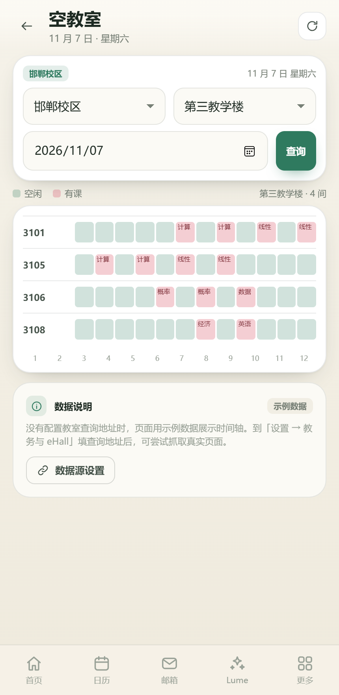 | 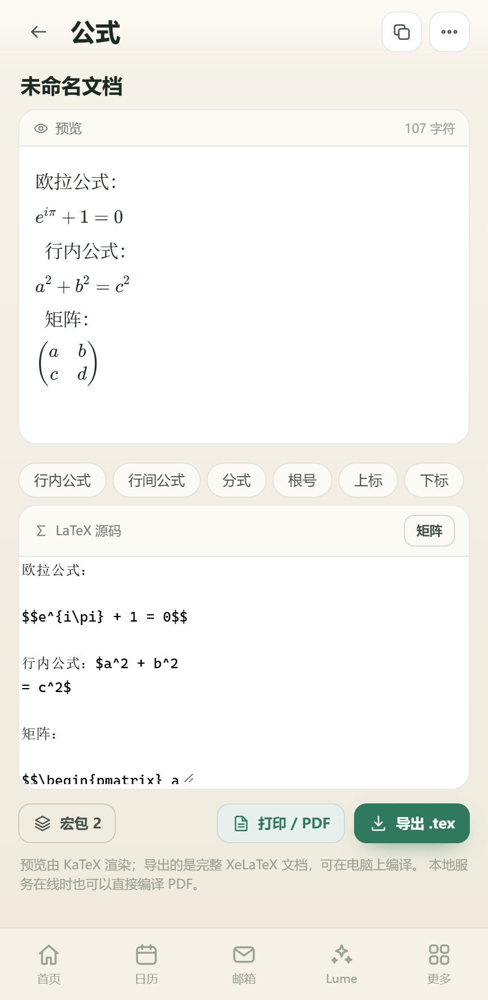 |

| 周视图 | 专注 |
| --- | --- |
| 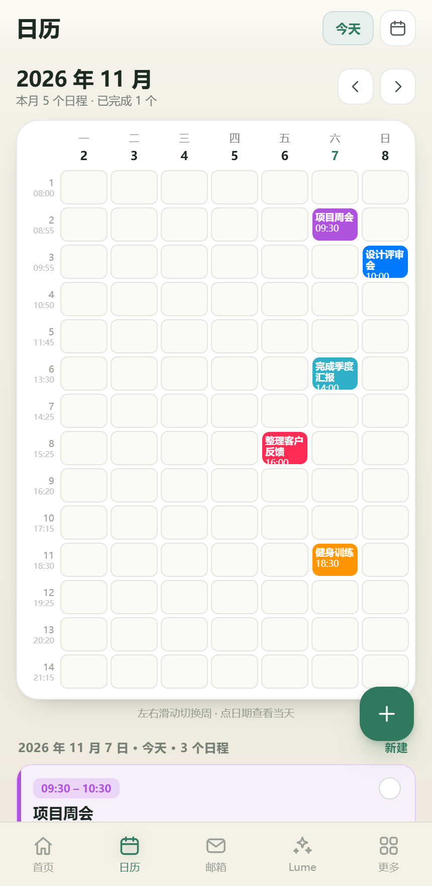 | 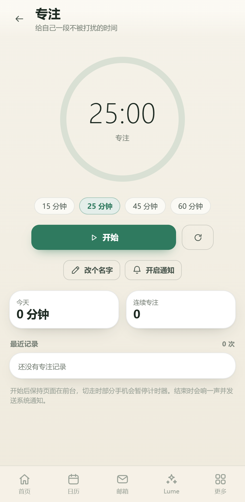 |

| 设置（浅色） | 设置（深色） |
| --- | --- |
| 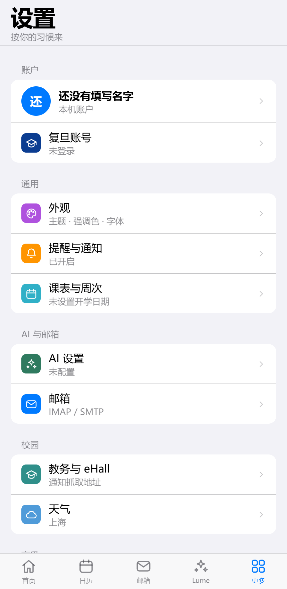 | 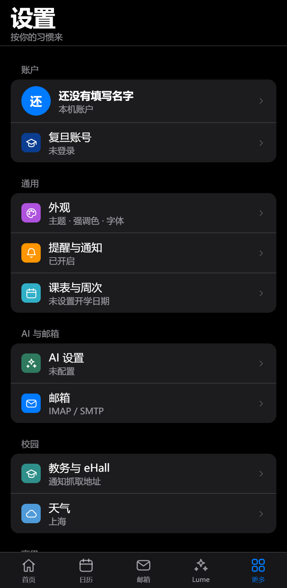 |

| 长按日程 |
| --- |
| 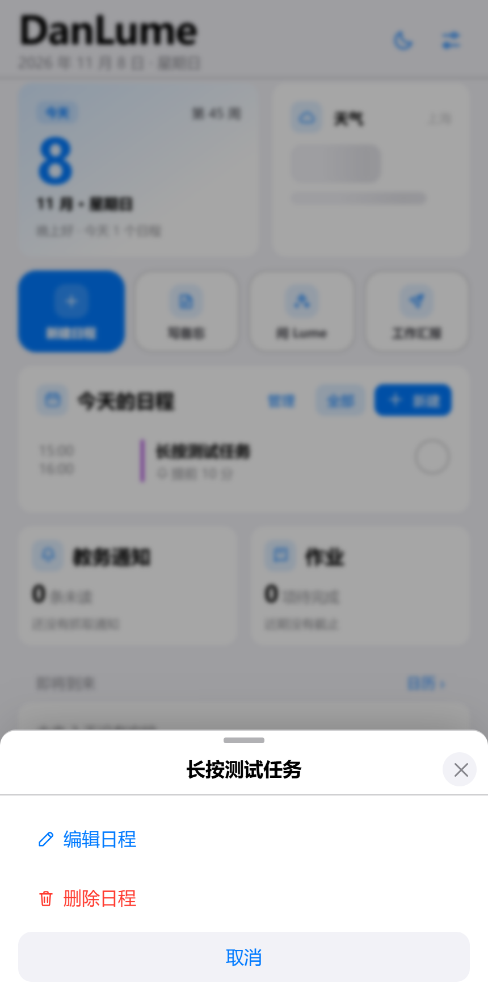 |

| 复旦身份验证 | 登录后自动同步 |
| --- | --- |
| 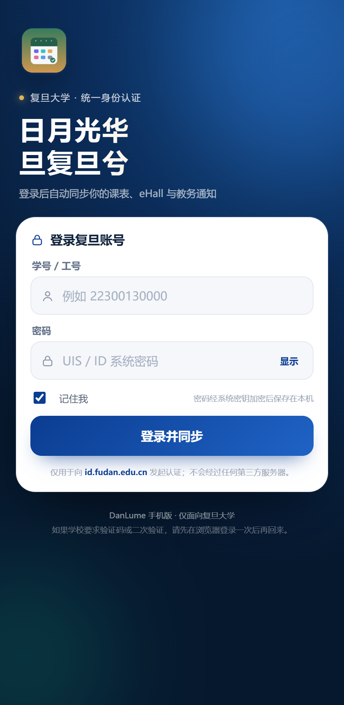 | 课表、教务通知、eHall 账号 |

---

## 复旦身份验证

手机版只面向复旦大学。第一次进入会先看到自绘的登录页（不是学校网页），
输入学号/工号与密码后，通过学校新版 ID 系统的加密接口（id.fudan.edu.cn）完成认证，
密码不会交给任何第三方。

- 登录成功后才能进入应用；密码用 Android Keystore 的 AES-GCM 加密保存在本机，
  下次启动自动恢复登录，不用反复输入。
- 登录后自动同步：本学期课表（本科 fdjwgl / 研究生 yjsxk，写入日历）、
  教务处通知（jwc 9397）、eHall 账号信息；登录 Cookie 会同步给应用内 WebView，
  在应用里打开 eHall 时尽量保持登录态。
- 学校要求验证码/二次验证时，会提示先在系统浏览器登录一次 id.fudan.edu.cn 再回来。
- 「设置 → 复旦账号」可以查看账号、切换本科/研究生、手动同步、退出登录。

> 这里不需要 start.bat。start.bat 只在网页版、或需要 XeLaTeX 编译时使用。

---

## 一分钟上手

1. 安装 **Node.js 18 或更新版本**（https://nodejs.org）。
2. 双击 **启动 DanLume 手机版.bat**（英文名 start.bat）。第一次会自动安装依赖。
3. 电脑上会打印两个地址和二维码：
   - 本机：http://127.0.0.1:8787/
   - 手机：http://电脑的局域网IP:8787/
4. 手机连同一个 Wi-Fi，扫码或输入「手机访问」地址。
5. 浏览器菜单 →「添加到主屏幕」，之后就像 App 一样打开。

> 不需要联网也能用：日程、备忘、文档、文献、公式全部存在手机浏览器本地。
> 网页版的邮箱、通知抓取、eHall 网页数据需要电脑上的这个小服务；APK 里这些都在手机上完成。

也可以只把 public/ 目录放到任意静态网站（或本机 python -m http.server）上打开，
核心功能（日历 / 备忘 / 文档 / 文献 / 公式 / AI）都不依赖后端。

---

## Android APK

已经打好安装包：**DanLume-1.3.2.apk**（约 2.4 MB，minSdk 24 / Android 7.0，targetSdk 34，已签名）。

首次启动会先验证复旦身份；登录成功后自动同步课表与教务通知，
之后启动会自动恢复登录，不需要反复输入密码。

### 1.3.2 AI 请求改为本地转发

- 修复「请求失败：Failed to fetch」：AI 请求不再由浏览器直连模型服务，
  改为先发到本机/电脑的 **/api/ai/chat** 转发，绕开 Safari/WebView 的 CORS/网络限制。
- 转发同时支持流式 SSE、模型列表测试；Android APK 内置转发，iPhone/网页版使用电脑上的 server.mjs。
- 错误会显示服务端返回的具体原因（401 Key 无效、402 余额、模型不存在等），不再只有 Failed to fetch。
- DeepSeek 模型名要填 **deepseek-chat** 或 **deepseek-reasoner**；填 deepseek 会提示模型不存在。
- iPhone 网页版/主屏幕 App 需要电脑上的 server.mjs 保持运行；只开静态网页时没有转发。

### 1.3.1 长按与邮件防打断

- 修复「用 AI 时邮箱页面突然弹出来」：邮件页的异步刷新现在会检查当前路由和根节点，
  离开邮箱后不再往共用的页面容器里写内容。
- 首页和日历的日程支持长按：弹出「编辑日程 / 删除日程 / 取消」。
  重复日程删除会提示删除整个系列；课表课程会提示下次同步会恢复。
- 删除同样会立刻刷新首页、日历和统计。

### 1.3.0 iOS 风格 UI

- 参考 iPhone「设置」重做视觉：分组圆角列表、大标题、纯黑深色模式、绿色开关、
  蓝色强调色、居中标题的底部弹层、iOS 风格分段控件。
- 设置页按「账户 / 通用 / AI 与邮箱 / 校园 / 高级」分组，彩色方形图标 + 右侧箭头。
- 状态栏、导航栏颜色跟随浅色/深色主题切换（APK 原生同步）。
- 移除设置页返回箭头，底部「更多」保持高亮；其它二级页面保留返回。
- 默认强调色切到 iOS 蓝，旧鼠尾草绿会迁移一次；外观里仍可改回。

### 1.2.3 颜色 / 新建 / AI 删除

- 课表同步的课程统一使用同一种颜色（teal）；个人任务使用 violet 等其它颜色。
  升级后会一次性把旧课程改成统一色，把个人任务里误用的课程色改成 violet。
- 删除日历右下角的大加号 FAB；新建统一走当天标题右侧的「新建」。
- AI 新增 delete_event 工具：可以先 list_events 查 id 再删除，也可以按标题精确删除；
  匹配到多条时会要求先按 id 指定，重复日程会删除整个系列。

### 1.2.2 清理 API 痕迹

- 删除源码里硬编码的访问密钥；新安装不再带任何可用密钥。
- 删除默认服务地址、模型名和模型预设；AI 设置默认留空。
- 界面里的「API Key / AI 接口 / API 已连接」等字样改为「访问密钥 / AI 设置 / 已连接」。
- 文档中“默认已填好 Key”的说明全部移除。
- 想继续用 AI：在「设置 → AI 设置」填自己的 OpenAI 兼容服务地址、访问密钥、模型名。

### 1.2.1 邮箱保存修复

- 修复「邮箱测试成功、保存却没反应」：AndroidKeyStore 默认要求 IV 由 Cipher 生成，
  旧代码自己传 IV，加密直接失败，账号被静默丢弃。现在改用 Cipher 生成的 IV。
- 保存/删除失败会明确提示，不再显示“账户已保存”的假成功。
- 收件、读信、发送失败时也会显示后端返回的具体错误。

### 1.2.0 手机邮箱

- **不再依赖电脑**：APK 内置 JavaMail（IMAP + SMTP），手机上直接用移动网络收发邮件。
- 支持 QQ / 163 / 126 / Gmail 一键预设，也支持手动填任意 IMAP/SMTP。
- 收件箱、HTML 邮件、内联图片、附件下载、回复 / 转发、草稿 / 已发送 / 失败重试都可用。
- 账号整段 JSON 用 Android Keystore AES-GCM 加密保存；密码不会离开手机。
- QQ / 163 / 126 用「授权码」，Gmail 用「应用专用密码」；Outlook 多数租户已禁用基础认证。
- 网页版仍可用电脑服务收发；APK 会优先走手机内置服务。

### 1.1.1 修复

- 修复日历「批量删除 / 批量完成」点击后不生效（内部变量名错误导致抛异常），
  这就是之前“删了还在、完成了统计不动”的原因。
- 完成状态改为**按每一次课/每一个日程实例**记录，不再整条重复日程一起标记；
  刷新、重启、重新同步课表都不会丢。
- 周视图新增「本周课程全部完成」，一键勾完本周课程。
- 首页统计改为「本周完成」，与本周进度一致。
- 新增「设置 → 数据与备份 → 清理示例日程 / 检查重复日程」，
  可清掉首次启动的示例记录和重复项。
- 新的安装不再写入示例日程，登录后直接同步真实课表。

安装：

1. 把 APK 传到手机（微信文件传输 / 数据线 / 网盘均可）。
2. 点开安装，首次需要允许「安装未知应用」。
3. 启动后在应用内起一个 127.0.0.1:18787 的本地服务来托管前端资源，
   所有页面、离线数据、AI 都在这台手机上运行。

和网页版的区别：

- 复旦登录、课表、教务通知、eHall 账号都在 APK 内完成，**不需要电脑**。
- 邮箱也在手机里收发，不需要电脑；只有 XeLaTeX 编译才需要可选的电脑服务：
  手机与电脑同一 Wi-Fi，在「设置 → 本地服务」填 http://电脑IP:8787。
- 第一次用邮箱：邮箱 → 添加账户 → 选 QQ/163/126/Gmail 预设 → 填邮箱地址和授权码 → 测试 → 保存。
- 下载走系统下载管理器，默认存到「下载」目录。
- PDF 预览取决于系统 WebView 是否内置 PDF 能力，打不开时用系统浏览器打开。
- 升级 APK 必须用同一份签名证书（android/danlume.keystore），否则要先卸载旧版。
- 没有做应用商店/自动更新；换新版直接覆盖安装即可。
- 安装新版后如果界面还是旧的，把应用从后台完全关掉再打开一次（Service Worker 需要切换）。

APK 的构建源码在 android/ 目录，重新打包：

    cd DanLumeMobile
    npm install
    powershell -ExecutionPolicy Bypass -File android\build-apk.ps1

需要 JDK 11+、android-35 的 android.jar、build-tools（aapt2 / zipalign / apksigner，
d8 建议用 build-tools 37）。详见 android/README.md。

---

## 功能一览（对照桌面版）

| 桌面版页面 | 手机版 | 说明 |
| --- | --- | --- |
| 仪表板 | 已实现 | 日期 / 教学周 / 天气、今日日程、未来 3 天、通知与作业概览、本周进度、eHall 小组件卡、专注入口 |
| 日历 | 已实现 | 月视图 + 课表式周视图、左右滑动换月/换周、5 种颜色、地点、备注、提醒提前量 |
| 重复日程 | 已实现 | 每天 / 每周 / 每月 / 每年；每月 31 日在没有 31 号的月份自动跳过；2/29 只在闰年出现；删除可选「只删这一次 / 删这次及以后 / 删全部」 |
| 提醒 | 已实现 | 应用内气泡 + 提示音 + 系统通知；准时、提前 5/15/30 分钟、1 小时、1 天；稍后 10 分钟；「出发提醒」按地点提前提醒 |
| 邮箱 | 已实现 | APK 内置 IMAP/SMTP：多账户、HTML、内联图片、附件、回复/转发、草稿/已发送/失败重试；网页版走本地服务 |
| 工作汇报 | 已实现* | 勾选本周日程 → 生成「本周完成 / 遇到的问题 / 下周计划」→ AI 润色 → 成果文件作为附件发出 |
| 通知 | 已实现* | 教务 / eHall 通知流、抓取、全部已读、只看未读、手动添加、打开原文 |
| 备忘 | 已实现 | 富文本：加粗 / 斜体 / 下划线、字号、颜色、有序 / 无序列表、待办勾选，输入即自动保存 |
| 作业 | 已实现 | 课程 / 标题 / 截止时间 / 要求 / 链接；写入日历（提前 30 分钟提醒）；AI 摘要；从日历反导入 |
| eHall | 已实现* | 常用服务入口、登录状态、按需内嵌网页（很多校园站禁止 iframe，会提示改用系统浏览器） |
| 空教室 | 已实现* | 校区 → 教学楼 → 教室三级筛选 + 横向时间轴；未配置数据源时用示例数据展示交互，配置后可抓取页面文字 |
| 文档 | 已实现 | PDF / 图片 / 文本 / 其它，本机存储、搜索、分类、PDF 与图片预览、下载 |
| 文献库 | 已实现 | 目录、星级、多选、中文概述（AI）、GB/T 7714 引用、BibTeX、EndNote 导出、步骤流程图（AI） |
| 公式 | 已实现 | LaTeX 编辑器 + KaTeX 实时预览、按钮式插入、图形化矩阵（可粘贴 Excel/TSV）、宏包勾选、导出 .tex、打印成 PDF、本机 XeLaTeX 编译 |
| AI | 已实现 | 流式对话、思考过程卡片、Markdown + LaTeX、图片/文本附件、会话历史、自行配置模型服务、可调用本地工具 |
| 设置 | 已实现 | 20+ 项：外观、提醒、课表周次、AI、邮箱、教务地址、天气、本地服务、备份、隐私 |
| 专注 | 已实现 | 番茄钟、环形进度、屏幕常亮、结束提示、专注记录 |
| 复旦身份验证 | 已实现 | 自绘登录页 → 学校 ID 系统认证；本机加密保存、自动登录；自动同步课表 / 通知 / eHall |
| 桌面端账号 / 管理员审核 | 不适用 | 手机版使用复旦身份验证，不涉及桌面客户端的注册审批流程 |

注：网页版需要电脑上的本地服务（server.mjs）配合；
APK 内置了复旦认证、课表/通知代理和 JavaMail，邮箱与教务都不需要电脑。

### AI 助手能做什么

- **流式回复**，带「思考过程」折叠卡片，显示「首字 0.7s · 168 字/秒」。
- **Markdown + LaTeX**：表格、代码块、行内公式、行间公式、pmatrix 等环境都能渲染。
- **让 AI 动手**（默认开启）：模型可以调用本地工具
  add_event / list_events / add_memo / search_memos / get_weather / daily_brief，
  说「明天下午三点安排项目评审会」就会真的写进日历。
- **附件**：可以粘贴/选择图片（模型支持视觉时直接读）、文本文件会拼进上下文。
- **模型服务自己配**：应用不内置服务地址、模型名或访问密钥；
  在「设置 → AI 设置」填入你自己的 OpenAI 兼容服务即可。

---

## 本地服务（网页版邮箱 / AI 转发 / LaTeX 需要）

复旦登录、课表、通知、eHall、邮箱和 AI 转发都已在 APK 内完成；下面这个服务供
网页版邮箱、网页版 AI 请求转发、XeLaTeX 编译 PDF 使用。

server.mjs 提供：

- 静态站点（手机访问同一份界面）
- /api/ai/chat、/api/ai/models：转发 AI 请求，绕开 Safari/WebView 的 CORS 与网络限制
- /api/mail/*：IMAP 收件、SMTP 发件、附件、标记已读 / 星标、多账户（密码用 AES-256-GCM 加密存在 data/mail-accounts.json）
- /api/web/*：带 Cookie 抓取校园网页（通知列表、仪表板卡片、空教室页面）
- /api/latex/compile：调用本机 xelatex 编译 PDF（装了 TeX Live / MiKTeX 才有）
- 终端二维码：手机扫码直接打开

启动后手机与电脑需在同一局域网。若 8787 被占用，可以运行 node server.mjs 9000 换端口。

### 邮箱配置

| 邮箱 | IMAP | SMTP | 密码 |
| --- | --- | --- | --- |
| QQ 邮箱 | imap.qq.com : 993 (SSL) | smtp.qq.com : 465 (SSL) | 网页版开启 SMTP 后的授权码 |
| 163 / 126 | imap.163.com : 993 | smtp.163.com : 465 | 客户端授权码 |
| Gmail | imap.gmail.com : 993 | smtp.gmail.com : 587 (STARTTLS) | 应用专用密码 |
| Outlook | outlook.office365.com : 993 | smtp.office365.com : 587 | 多数租户已禁用基础认证 |

APK 里在「邮箱 → 添加账户」里选预设或手动填，点「测试」确认 IMAP/SMTP 都正常再保存；
网页版则通过电脑服务使用同一套账户。

---

## 数据与隐私

- 日程、备忘、通知、作业、文档、文献、对话存在**应用内 IndexedDB**，不上传服务器。
- APK 的邮箱账号整段 JSON 用 Android Keystore AES-GCM 加密，存在应用私有 SharedPreferences；
  网页版才由电脑 data/mail-accounts.json（AES-256-GCM）保存，前端拿不到明文。
- 天气用 Open-Meteo（只发送经纬度）；AI 请求直接发给你自己配置的模型服务。
- 换手机 / 换浏览器前，先在「更多 → 导出备份」存一份 JSON；新设备「导入备份」即可。
- 清除浏览器站点数据 / 清除应用数据会清空本地数据，请定期备份。

---

## 目录结构

    DanLumeMobile/
      server.mjs                 本地服务：静态站点 + 邮箱桥 + 网页抓取 + LaTeX
      server/
        fudan.mjs                新版 ID 认证 + 课表/通知代理（网页版用）
        mail.mjs                 IMAP / SMTP / 附件（imapflow + nodemailer + mailparser）
        web.mjs                  带 Cookie 的网页抓取与通知提取
      public/
        index.html               应用外壳
        manifest.webmanifest     PWA（可添加到主屏幕）
        sw.js                    离线缓存
        css/app.css              设计系统：主题、组件、日历、聊天、时间轴
        js/
          main.js                启动、路由注册
          shell.js               路由 / 顶栏 / 底栏
          db.js                  IndexedDB + 默认设置 + 备份
          util.js                日期、重复规则、格式化
          ui.js                  弹层、对话框、主题、组件
          ai.js                  OpenAI 兼容流式客户端
          tools.js               AI 可调用的本地工具
          markdown.js            Markdown + KaTeX（含行间公式预处理）
          reminders.js           提醒轮询、系统通知、提示音
          eventEditor.js         日程编辑器（含重复实例删除）
          api.js                 本地服务桥
          fudan.js               复旦认证、课表/通知同步
          login.js               自定义复旦登录页
          weather.js             天气
          views/                 16 个页面
        vendor/                  KaTeX / marked / DOMPurify
      docs/screenshots/          截图
      data/                      运行时数据（邮箱账号、Cookie、LaTeX 中间文件）
      android/
        AndroidManifest.xml
        build-apk.ps1            无 Gradle 打包脚本
        java/.../FudanAuth.java  新版 ID 认证 + Cookie 代理
        java/.../MailService.java JavaMail 收发 + MIME 解析
        java/.../MailPrefsStore.java 邮箱账户加密保存
        java/.../SecureBox.java  Keystore AES-GCM 封装
        java/.../PrefsStore.java Keystore 加密保存账号
        java/.../LocalServer.java 应用内静态服务 + /api/fudan + /api/mail + /api/ai
        libs/                    JavaMail for Android 1.6.7
      start.bat / 启动 DanLume 手机版.bat
      package.json

## 开发与自检

    npm install
    node server.mjs            # 开发时直接跑
    node tools/syntax.mjs      # 检查所有前端模块语法
    node tools/test-util.mjs   # 重复日程 / 月份矩阵单元测试

浏览器直接打开 http://127.0.0.1:8787/ 就是应用；F12 可切设备工具栏模拟手机。

## 已知限制

- **提醒依赖页面存活**：手机浏览器在后台可能暂停定时器；系统通知需要在浏览器里授权。
- **登录依赖学校 ID 系统**：需要能访问 id.fudan.edu.cn；学校要求验证码或二次验证时，
  请先在系统浏览器登录一次再回到应用。
- **课表 / 通知接口可能变化**：学校页面或 JSON 结构更新时，同步会失败并给出提示；
  登录本身不受影响，可以稍后重试。
- **手机邮箱依赖服务商策略**：QQ / 163 / 126 必须使用授权码并开启 IMAP，Gmail 要用应用专用密码；
  Outlook 多数租户关闭了基础认证，无法用账号密码直连（需要 OAuth，暂未实现）。
- 校园邮箱若限制校外 IP 或强制 VPN，手机网络下可能连不上，需要先连学校 VPN。
- **eHall / 空教室**的真实数据结构与学校页面相关，空教室当前用「抓取页面文字 + 示例时间轴」的方式呈现。
- **eLearning 一键下载作业**没有移植：浏览器无法稳定访问需要登录态的课程文件，改为「作业清单 + 截止写入日历 + AI 摘要」。
- **AI WebUI 对话 / 读取微信消息**是桌面端借助本机程序实现的能力，浏览器里没有对应权限，未包含。
- **账户注册 / 管理员审核**属于桌面客户端的管理流程；手机版只做复旦身份验证，不使用桌面端的注册审批。

## 与原始项目的关系

页面、字段、颜色、提醒提前量、重复规则、提示词、汇报模板都对照
DanLume-1.0.0-client-source 的 Python/PySide6 版本重写为移动端实现；
数据模型（events / memos / notices / homework / lits / chats）保持同样的语义，
因此桌面版导出的字段可以一一对应到手机版。

—— 用 Lume 把这周过明白。

## 著作权与许可（GPL-3.0）

- 手机端基于 **lmq（GitHub: @BellaSILVERWOOD）** 的 DanLume Python 桌面版移植；
- 手机端开发：**lcy（LinkCutY@qq.com）**；
- 桌面端（Python 版 / Rust 版）著作权归 **lmq（@BellaSILVERWOOD）** 所有。

本项目以 **GNU General Public License v3.0（GPL-3.0）** 开源，全文见仓库根目录 \LICENSE\。
分发衍生作品必须同样以 GPL-3.0 开源，并保留上面的署名与变更说明。

Copyright (C) 2026 lmq (@BellaSILVERWOOD) · 手机端开发 lcy <LinkCutY@qq.com>
